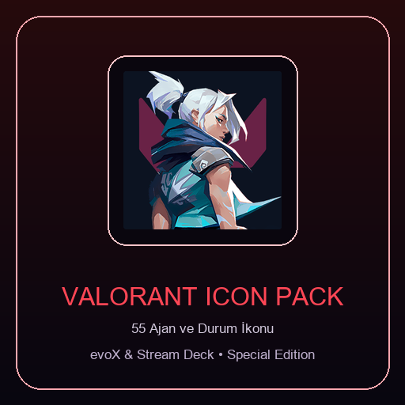

  
  <h1>Valorant Icon Pack (55 Retina Icons)</h1>
  
<strong>Official Valorant Agents (Active & Offline) & Custom Identity Icon Suite for Elgato Stream Deck & evoX.</strong>

  

    <strong>Language / Dil:</strong> <a href="README.md"><strong>English</strong></a> | <a href="README.tr.md"><strong>Türkçe</strong></a>
    &nbsp;•&nbsp;
    <a href="https://github.com/Hfatih/valorant-icon-pack/releases/latest">Download .evoxpack</a> ·
    <a href="https://hfatih.github.io/valorant-icon-pack/">Live Interactive Gallery</a> ·
    <a href="#installation--usage">How to Install</a>
  

  

    
    
    
    
    
    
    
  

  

    
    
    
    
    
  

---

## 🕹️ Live Interactive Web Simulator & Gallery
Test and preview all 55 icons directly on an interactive 15-key virtual Stream Deck hardware simulator:  
👉 **[Open Live Simulator on GitHub Pages](https://hfatih.github.io/valorant-icon-pack/)**

- **15-Key Hardware Frame:** Realistic LCD key click mechanics and tactile state changes.
- **Search & Role Filtering:** Instant live filter by Duelist, Initiator, Controller, Sentinel, or Offline status.
- **Random 15 Fill:** Instantly load a randomized 15-key agent setup onto the deck.
- **Direct Package Download:** One-click download button for `Valorant Icon Pack.evoxpack`.

---

## 📖 Overview
The **Valorant Icon Pack** is an ultra-crisp, high-definition icon suite designed for **Elgato Stream Deck**, **evoXdeck**, **Loupedeck**, and **Touch Portal**. 

Every single one of the 25 official Valorant agents is meticulously rendered with dual state awareness:
1. **Active State (On):** Full-color, high-contrast agent portrait with signature character color grading.
2. **Offline State (Kapalı / Off):** Desaturated, darkened silhouette state designed for mute keys, offline agent selection, eliminated teammates, or disabled toggle buttons.

Additionally, the suite includes official Valorant emblems and custom stylized logo variants in classic, bright, dark, pink, and 40% translucent styles.

---

## 👥 Complete Agent Roster (55 Icons)

### ⚔️ Duelists
- **Jett** (`Jett.png`, `Jett-Kapalı.png`)
- **Reyna** (`Reyna.png`, `Reyna-Kapalı.png`)
- **Phoenix** (`Phoenix.png`, `Phoenix-Kapalı.png`)
- **Raze** (`Raze.png`, `Raze-Kapalı.png`)
- **Neon** (`Neon.png`, `Neon-Kapalı.png`)
- **Iso** (`Iso.png`, `Iso-Kapalı.png`)
- **Yoru** (`Yoru.png`, `Yoru-Kapalı.png`)

### 🎯 Initiators
- **Sova** (`Sova.png`, `Sova-Kapalı.png`)
- **Fade** (`Fade.png`, `Fade-Kapalı.png`)
- **Breach** (`Breach.png`, `Breach-Kapalı.png`)
- **Skye** (`Skye.png`, `Skye-Kapalı.png`)
- **Gekko** (`Gekko.png`, `Gekko-Kapalı.png`)
- **KAY/O** (`Kayo.png`, `Kayo-Kapalı.png`)

### ☁️ Controllers
- **Omen** (`Omen.png`, `Omen-Kapalı.png`)
- **Brimstone** (`Brimstone.png`, `Brimstone-Kapalı.png`)
- **Viper** (`Viper.png`, `Viper-Kapalı.png`)
- **Astra** (`Astra.png`, `Astra-Kapalı.png`)
- **Harbor** (`Harbor.png`, `Harbor-Kapalı.png`)
- **Clove** (`Clove.png`, `Clove-Kapalı.png`)

### 🛡️ Sentinels
- **Killjoy** (`Killjoy.png`, `Killjoy-Kapalı.png`)
- **Cypher** (`Cypher.png`, `Cypher-Kapalı.png`)
- **Sage** (`Sage.png`, `Sage-Kapalı.png`)
- **Chamber** (`Chamber.png`, `Chamber-Kapalı.png`)
- **Deadlock** (`Deadlock.png`, `Deadlock-Kapalı.png`)
- **Vyse** (`Vyse.png`, `Vyse-Kapalı.png`)

### ⚡ Logos & Badges
- **Valorant Master Logo** (`Logo.png`)
- **Logo Açık / On** (`Logo-Açık.png`)
- **Logo Kapalı / Off** (`Logo-Kapalı.png`)
- **Logo Pembe / Pink** (`Logo-Pembe.png`)
- **Logo Pembe 40% Translucent** (`Logo-Pembe-40.png`)

---

## 🚀 Installation & Usage

### 1. Elgato Stream Deck / Loupedeck
1. Extract or open the `icons/` directory.
2. Drag and drop any `.png` file directly onto your desired key in the Stream Deck software.
3. Use the matching `-Kapalı.png` variant as the secondary state for toggle actions.

### 2. evoX Action Deck
1. Download `Valorant Icon Pack.evoxpack` from [Releases](https://github.com/Hfatih/valorant-icon-pack/releases/latest).
2. Double-click the file or use **Import Package** inside evoX.
3. All 55 agent icons will automatically appear in your evoX Icon Library.

---

## 🛠️ Technical Specifications
- **Format:** High-resolution 32-bit RGBA PNG
- **Dimensions:** Native 144x144 Retina display resolution (pixel-perfect on hardware LCD keys)
- **Validation:** 100% compliant with evoX Zod manifest validator (`EvoxArchivePolicy`)
- **Payload Size:** Ultra-lightweight ~10.8 MB compressed archive

---

## 📄 License & Legal Notice
Distributed under the [MIT License](LICENSE). Valorant and agent logos are trademarks or registered trademarks of Riot Games, Inc. This project is an unofficial fan creation.
